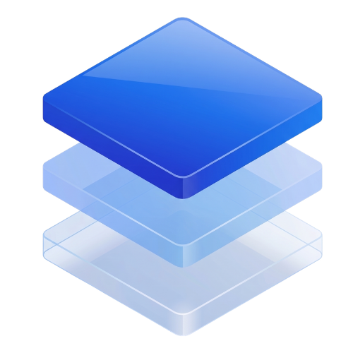
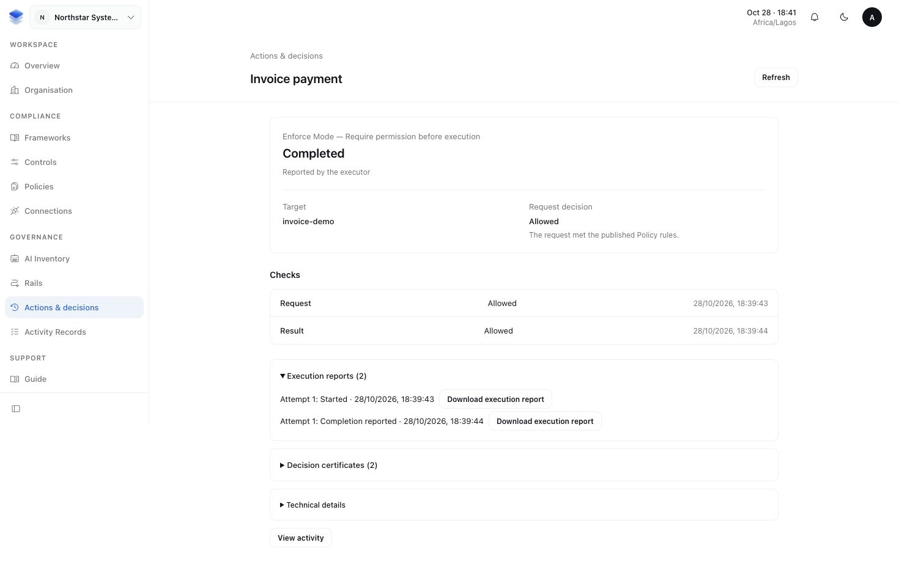

  

# AuthRail

AuthRail helps organisations govern how they use AI. Understand what your AI
systems are doing, control which actions they can take, and bring sensitive
decisions to a human for approval. Connect that oversight to your organisation's
policies and compliance requirements.

**[Read the documentation](https://docs.authrail.io)** ·
**[Open the workspace](https://app-staging.authrail.io)**

## From requirements to working practices

An organisation needs to know which obligations apply to its AI systems and
how it meets them. AuthRail connects that work in one workspace:

- **Frameworks** organise obligations from standards, regulations and your own
  organisation. Choose an exact version, define its scope and review what applies.
- **Policies and Controls** describe what your organisation expects and how its
  teams put those expectations into practice. Reuse the same approved practice
  across Frameworks.
- **Tests and Evidence** check whether those practices work and retain the
  material reviewed to support the result.
- **Readiness** shows what is supported by up-to-date reviewed proof and what still
  needs attention. Findings, Tasks and narrow Exceptions help teams handle gaps
  without erasing earlier results.

For example, a support team may require human review before an AI assistant
makes sensitive account changes. Its Policy records that expectation; its
Control describes the review process; its Tests and Evidence show whether the
process worked over the assessed period.

[Start with the product introduction](https://docs.authrail.io/docs), then follow
[Frameworks and scope](https://docs.authrail.io/docs/frameworks).

## Bring the rules to AI actions

AuthRail **Runtime** connects reviewed rules, called **Rails**, to the application
where an AI system calls a tool or receives its result. Your application uses
an SDK and a customer-side **sidecar** to check those rules. It keeps its own
business logic and provider credentials.

Start in **Observe** to see what the rules would decide. Move a reviewed,
protected path to **Enforce** to require permission before an operation runs and
withhold results that should not reach the agent. Requests can require a named
human reviewer before the application continues.

Actions bring together the request, decisions, approvals and application reports
so reviewers can understand what happened. Permission, reported execution and
independently verified effects remain distinct. Runtime records support
compliance through the relevant Control's Test or Evidence review.

*An example Action: request and result checks are allowed, and completion is
reported by the executor. Those records do not independently prove a provider effect.*

[Understand Runtime](https://docs.authrail.io/docs/concepts) before
[connecting your first application](https://docs.authrail.io/docs/getting-started).

## Public repositories

| Repository | Purpose |
| --- | --- |
| [AuthRail Sidecar](https://github.com/AuthRail/authrail-sidecar) | Run the local rule checker with Docker or a native binary. Includes the supported OpenShell integration. |
| [Node SDK](https://github.com/AuthRail/authrail-sdk-node) | Connect TypeScript and JavaScript applications to the sidecar. |
| [Go SDK](https://github.com/AuthRail/authrail-sdk-go) | Connect Go applications through the same decision protocol. |
| [Documentation](https://github.com/AuthRail/authrail-docs) | This public product documentation and website. |

Docker builds the sidecar from source inside its build stage; you do not need
to compile a native binary first. The SDK belongs in the protected application.
See [Docker setup](https://docs.authrail.io/docs/docker),
[Node setup](https://docs.authrail.io/docs/node) and
[Go setup](https://docs.authrail.io/docs/go) for prerequisites and the full steps.

## OpenShell and integration references

The supported [OpenShell integration](https://docs.authrail.io/docs/openshell)
uses customer-operated [NVIDIA OpenShell](https://github.com/NVIDIA/OpenShell)
for sandbox containment while AuthRail checks business actions through the
protected executor. See the [official OpenShell documentation](https://docs.nvidia.com/openshell/latest/)
for its installation and sandbox responsibilities.

Our integration research also draws on
[OpenAPPA's tool-call and tool-result interception patterns](https://www.openappa.com/how-it-works).
AuthRail has its own sidecar protocol, Rails, approval lifecycle and retained
records; the AuthRail guides describe the supported integration contract.
